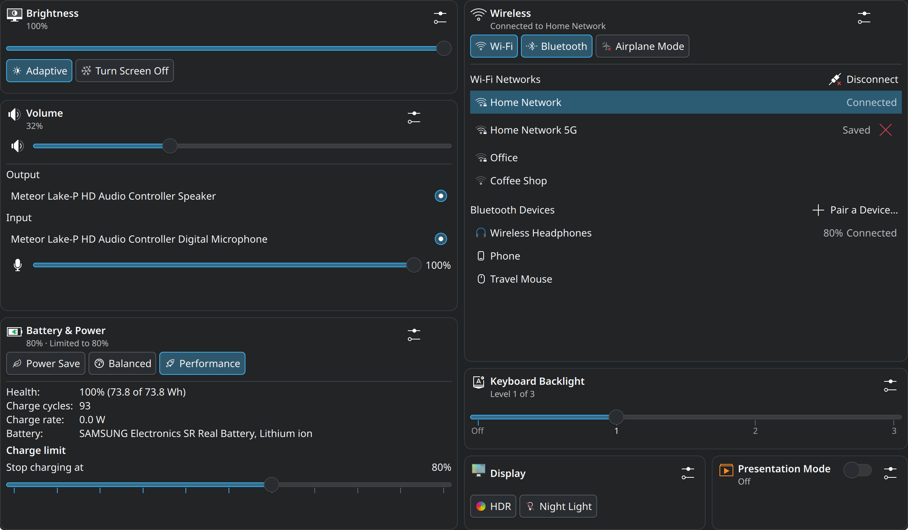
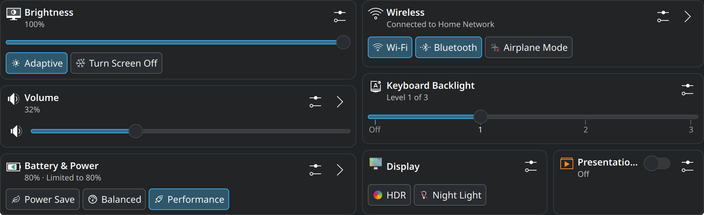
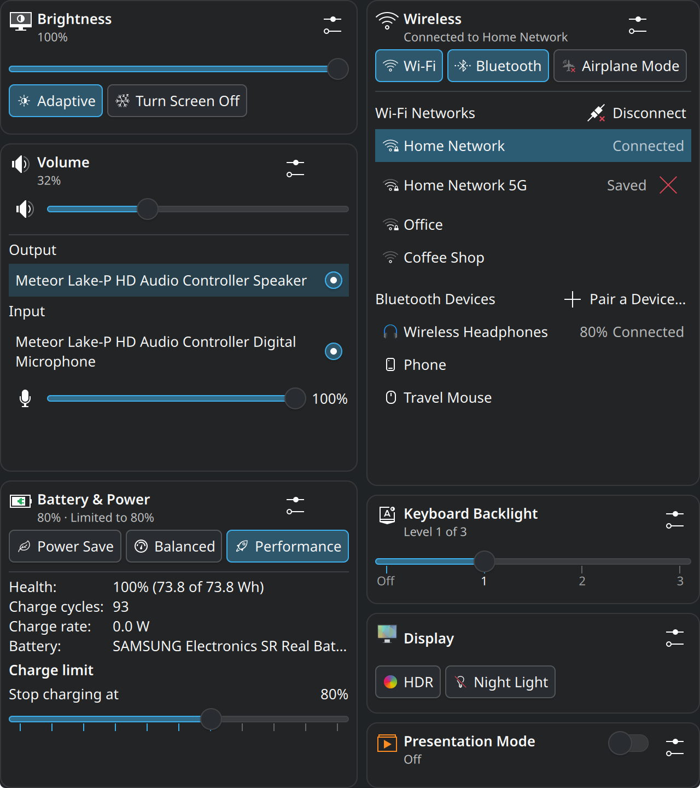
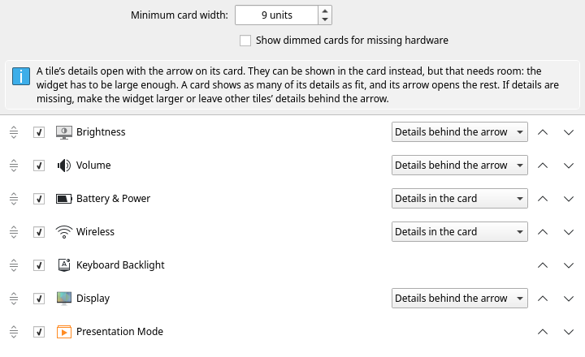

# Mobility Center

A KDE Plasma 6 desktop widget inspired by the Windows Mobility Center: the
laptop controls you reach for on the move — brightness, volume, battery and
power profile, Wi-Fi and Bluetooth, keyboard backlight, display and
presentation mode — as quick-settings cards in one place.



## Features

| Tile | On the card | Details |
|---|---|---|
| Brightness | percentage and slider, adaptive brightness, turn the screen off | one slider per display, when there are several |
| Volume | percentage, slider, mute | output and input device pickers, microphone volume and mute |
| Battery & Power | charge, AC state, time remaining, power profile chips | health, charge cycles, charge or discharge rate, charge limit |
| Wireless | Wi-Fi and Bluetooth toggles, current network, airplane mode | Wi-Fi networks (connect, disconnect, forget), paired Bluetooth devices (connect, disconnect, battery) |
| Keyboard Backlight | slider with a mark per level | — |
| Display | refresh-rate toggle (on panels with several rates), HDR, Night Light | projection: laptop screen only, mirror, extend, external screen only |
| Presentation Mode | on/off: no automatic sleep, dimming or screen lock, Do Not Disturb, Night Light paused | — |

* The cards always fill the widget and share it by content: a card with
  more to show gets more room, light cards sit side by side, and the
  configured order is kept. The cards only rearrange when you resize the
  widget or change its settings; the widget never scrolls.
* A tile's details open with the arrow on its card, in a flyout beside the
  widget. In the settings you can have them shown in the card instead, per
  tile; that needs a large enough widget — a card shows as many of its
  details as fit, and the arrow opens the rest.
* Tiles whose hardware or service is missing hide themselves (or show
  dimmed, if you prefer).
* Every card links to the matching System Settings page.
* Choose and order the tiles in the widget's settings.
* Works with the standard widget background, or "cards only" with the
  background switched off.
* Uses only public interfaces (D-Bus services, KDE libraries, KAuth); the
  widget ships no privileged code of its own.

|  |  |
| :-- | :-- |
| The default: every card shows its controls, and the arrow opens its details beside the widget. The layout follows the widget's shape. | The same tiles in a tall widget, with details set to show in the cards. |



## Requirements

Plasma 6.3 or newer (KDE Frameworks 6.10, Qt 6.7). Some features depend on
the Plasma version:

* the tray's airplane icon follows the widget on Plasma 6.5+;
* real (non-emulated) display mirroring needs Plasma 6.4+ on Wayland.

## Dependencies

Install these first — the build fails without them.

**Fedora**

```bash
sudo dnf install cmake gcc-c++ extra-cmake-modules gettext \
    qt6-qtbase-devel qt6-qtdeclarative-devel \
    kf6-solid-devel kf6-kauth-devel kf6-kconfig-devel \
    pulseaudio-qt-qt6-devel libcanberra-devel \
    kf6-networkmanager-qt-devel libkscreen-devel
```

**Debian / Ubuntu**

```bash
sudo apt install cmake g++ extra-cmake-modules gettext \
    qt6-base-dev qt6-declarative-dev \
    libkf6solid-dev libkf6auth-dev libkf6config-dev \
    libkf6pulseaudioqt-dev libcanberra-dev \
    libkf6networkmanagerqt-dev libkscreen-dev
```

**Arch**

```bash
sudo pacman -S --needed base-devel cmake extra-cmake-modules gettext \
    qt6-base qt6-declarative solid kauth kconfig \
    pulseaudio-qt libcanberra networkmanager-qt libkscreen
```

The Fedora and Debian lines have been run; the Arch package names were
looked up, not installed — corrections are welcome. Everything the widget
needs at run time is part of a normal Plasma 6 desktop.

## Build and install

```bash
git clone https://github.com/Cir0cuit/plasma-mobility-center.git
cd plasma-mobility-center
./install.sh
```

`install.sh` configures and builds the project, then installs both halves:
the four QML modules with `sudo cmake --install` (they have to land on Qt's
import path) and the applet with `kpackagetool6` for the current user only.
It will ask for your password for the first of those.

Restart plasmashell afterwards so it picks up the new QML modules:

```bash
systemctl --user restart plasma-plasmashell.service
```

Then add it from the desktop context menu: *Add Widgets… → Mobility Center*.
To remove everything again, including the polkit rule below, run
`./uninstall.sh` — take the widget off the desktop first.

### From the KDE Store

*Get New Widgets* can deliver only the applet half: it unpacks QML into your
home directory, and the compiled modules have to sit on Qt's own import
path, which only root can write to. Installed that way, the widget appears
and says that its backend is missing, with a button that leads here. Build
it once with the commands above and it starts working.

### Battery charge limit

Changing the battery charge limit goes through PowerDevil's own helper,
which normally asks for an administrator password every time. The Battery &
Power details therefore first offer **Allow Changing the Limit…**: it
installs an optional polkit rule (`data/polkit/`, copied to
`/etc/polkit-1/rules.d/` with `pkexec`, one password prompt) that lets the
user of the active local session change the limit without a password. The
slider appears once that permission is in place. `./install.sh
--polkit-rule` installs the rule up front instead.

## Development

Build and test without installing anything:

```bash
cmake -B build -S .
cmake --build build -j"$(nproc)"
ctest --test-dir build --output-on-failure
```

The tests never touch the running session: CTest gives every test a private
(or unusable) D-Bus, a scratch `XDG_CONFIG_HOME`, an unreachable sound server
and libkscreen's Fake backend (see `test/mocks/README.md`). Backend tests use
python-dbusmock (`python3-dbusmock` / `python-dbusmock`).

Run the widget from the build tree:

```bash
QML_IMPORT_PATH=$PWD/build/qml plasmoidviewer -a $PWD/package -f planar
```

Layout of the source tree:

* `src/core`, `src/audio`, `src/network`, `src/display` — one C++ QML module
  each (`io.github.cir0cuit.mobilitycenter.<name>`); `src/common` holds
  header-only D-Bus helpers;
* `package/` — the applet: `CenterView.qml`, the card grid (`CardGrid.qml`,
  `layout.js`), shared controls and one file per tile in `tiles/`;
* `test/cpp` — QtTest unit tests, `test/qml` — qmltestrunner tests of the
  JavaScript libraries, `test/mocks` — how backend tests mock D-Bus services;
* `po/Messages.sh` — extracts the translatable strings.

## How this was built

This widget was written with an AI coding agent — Claude Code — doing the
implementation, under human direction and review.

That is a statement of fact rather than an excuse, but it comes with limits
worth stating plainly, so here is what has actually been run.

It has been built, installed and used on two systems:

* **Fedora 44** — Plasma 6.7.5 on Wayland, Qt 6.11.2, GCC 16.2, on a laptop
  with one internal HDR panel, a three-level keyboard backlight, a battery
  with a charge limit, Wi-Fi and Bluetooth. The development machine, and the
  one with by far the most hours on it: the widget has lived on a real
  desktop there, was resized and reconfigured many times, and its tiles
  showed the machine's real state.
* **Debian** — with KDE Plasma 6.

Changing state from the widget has had far less exercise on real hardware
than reading it; most of that is covered only by the tests below.

The backends are covered by unit tests that run against mocked D-Bus
services (PowerDevil, UPower, power-profiles-daemon, NetworkManager, KWin
Night Light and the inhibition services) and libkscreen's fake backend, and
the layout and the cards by QML tests.

What has not been tried: Arch and other distributions, older Plasma versions,
X11, an external
screen (so projection and per-display brightness have only met their
tests), panels with several refresh rates, mobile broadband, and machines
without some of the hardware. If it misbehaves, the useful bug report is the
one that says what your setup was.

## Contributing

Contributions are welcome. Anything that meets a high quality bar will be
considered and, most likely, merged — a clear description of the problem, a
change that does one thing, and evidence that you ran it.

AI-assisted contributions are equally welcome, on one condition: a human has
to have verified them. Either you understand what the agent produced well
enough to defend it line by line, or you have tested it thoroughly enough to
know it works. Both is better.

What will not be accepted is unverified output submitted on the assumption
that someone else will check it: patches that break existing behaviour, that
make the widget unusable, or that fix bugs which do not exist. Reviewing that
costs more than writing it did, and repeatedly submitting it is grounds for a
ban.

If you are unsure whether an idea fits, open an issue before writing the
code.

## License

GPL-2.0-or-later. See `LICENSE`.
